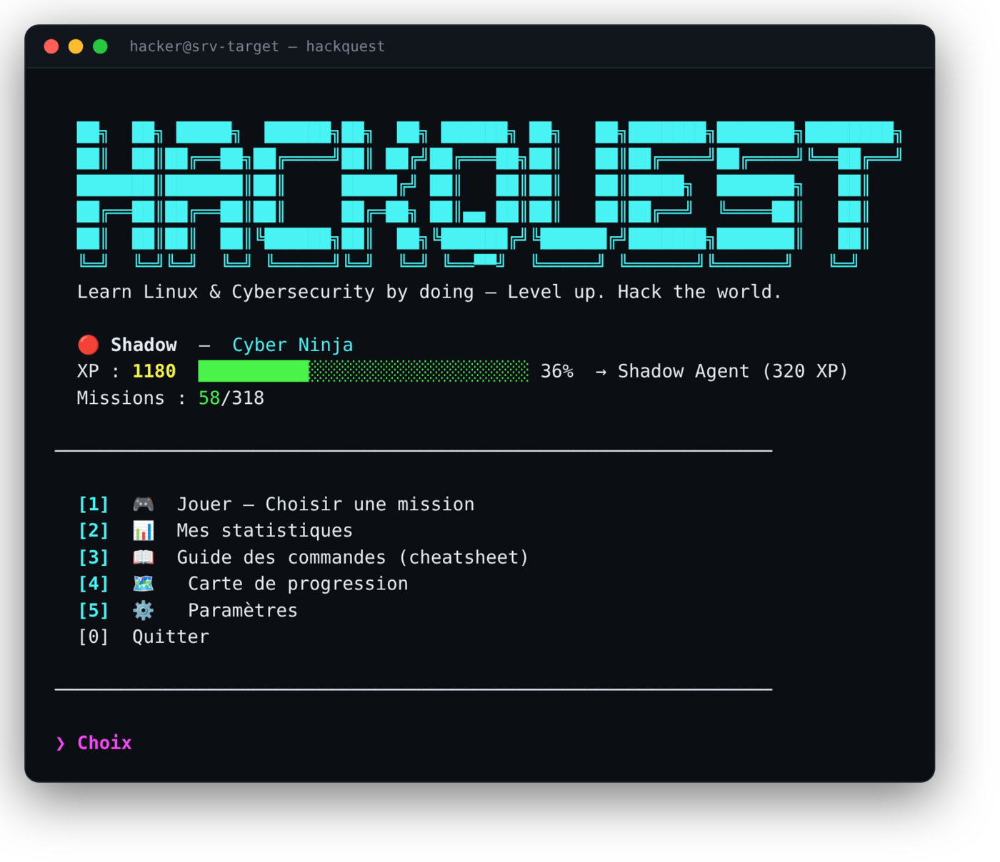
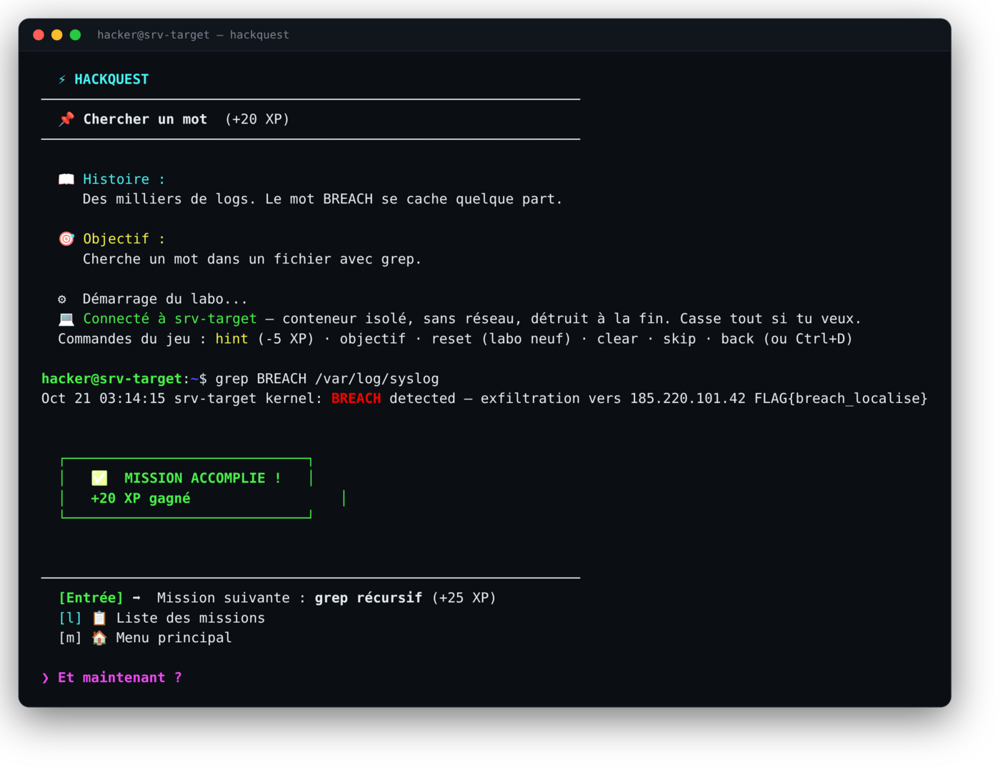
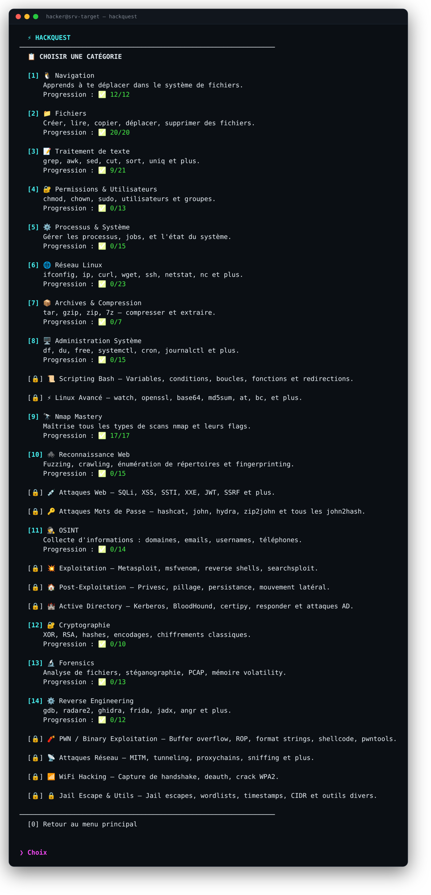
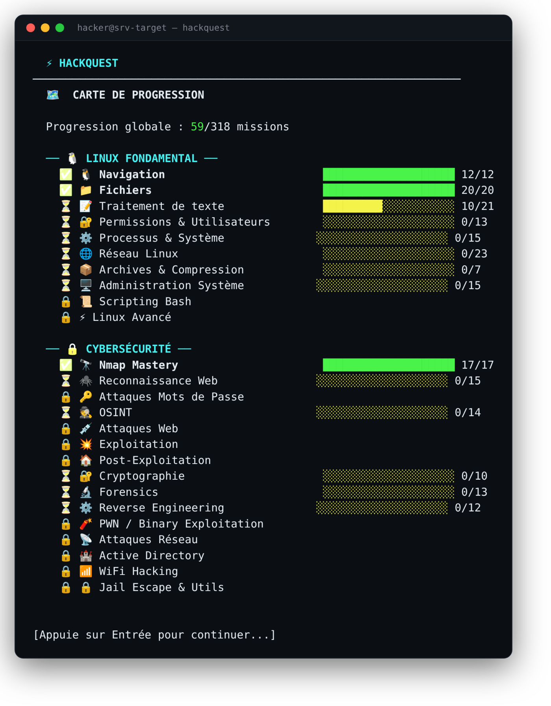

<div align="center">

# 🎮 HackQuest

**Apprends Linux et la cybersécurité en jouant — directement dans ton terminal.**

Chaque mission te raconte une histoire, tu tapes la vraie commande, tu gagnes de l'XP et tu montes en grade.
Les missions avancées se jouent dans un **vrai shell**, sur un faux serveur compromis isolé.




</div>

---

## ✨ Pourquoi HackQuest

La plupart des tutos te font **lire**. HackQuest te fait **faire**. Tu n'apprends pas une commande en la recopiant : tu la tapes sur une vraie cible, et la mission n'est validée que si **le résultat est là** — le flag trouvé, le fichier créé, le bon dossier atteint.

<div align="center">

</div>

Ici, `grep` tourne pour de vrai dans un conteneur jetable, trouve le flag caché dans les logs, et la mission se valide. Puis le jeu enchaîne direct sur la suivante.

---

## 🚀 Installation

```bash
curl -sSL https://raw.githubusercontent.com/jordanwinner/hackquest/master/install.sh | bash
```

Puis, quand tu veux jouer :

```bash
hackquest
```

L'installeur enregistre la commande dans ton `PATH` (ouvre un nouveau terminal si besoin). Il est **idempotent** : relance-le autant de fois que tu veux, il met à jour sans rien casser et garde ta progression.

### Pour le vrai shell (optionnel mais recommandé)

Les missions marquées **💻 labo** ont besoin de **Docker** :

```bash
sudo apt install docker.io
sudo usermod -aG docker $USER      # puis déconnecte-toi / reconnecte-toi
```

Sans Docker, le jeu fonctionne quand même : ces missions passent en **mode texte**. Le conteneur du labo est construit automatiquement au premier lancement (~670 Mo, une seule fois), ne tourne **que pendant une mission**, et est **détruit juste après**.

---

## 🎯 Fonctionnalités

- **318 missions**, 25 catégories, de `pwd` au reverse engineering.
- **113 missions dans un vrai shell** : tes commandes s'exécutent réellement, la validation se fait sur le résultat.
- **Progression & grades** : XP, 8 rangs (de *Newbie* à *Legend*), catégories qui se débloquent au fil de l'eau.
- **Enchaînement fluide** : après une réussite, tu passes à la mission suivante ou au niveau suivant sans repasser par le menu.
- **Indices** (`hint`), **cheatsheet** intégrée, **carte de progression**, **statistiques** détaillées.
- **Sans risque** : chaque labo tourne dans un conteneur isolé, sans réseau, en utilisateur non-root — tu peux tout casser.
- **Reprend où tu t'es arrêté** : sauvegarde automatique et robuste (écriture atomique + copie de secours).

---

## 📸 Aperçu

<div align="center">

**Choisir une catégorie** · les catégories se débloquent avec ta progression


**Carte de progression**


</div>

---

## 🧠 Comment ça marche

```
 hackquest (ton terminal)                     Conteneur Docker « srv-target »
 ┌────────────────────────┐    commande    ┌────────────────────────────────┐
 │ hacker@srv-target:~$   │ ─────────────► │ bash (utilisateur non-root)    │
 │ grep BREACH /var/log.. │                │ faux logs, flags, binaires...  │
 │                        │ ◄───────────── │ pas de réseau, jetable         │
 │ ✅ MISSION ACCOMPLIE   │    résultat    └────────────────────────────────┘
 └────────────────────────┘                 détruit à la fin de la mission
```

1. **Le monde** (`lab/world.py`) construit une fois un faux serveur compromis : logs avec une attaque cachée, fichiers planqués, binaire SUID, image stéganographiée, capture réseau, crackme…
2. **La mission** lance un conteneur neuf et ouvre un shell `bash` dedans. `cd`, variables et fichiers persistent pendant toute la mission.
3. **La validation** exige **la bonne commande** (`core/validate.py`) **ET** le bon résultat (`core/labs.py`) : un `cat` qui affiche le flag ne valide pas une mission `grep`.
4. **La fin** : le conteneur est supprimé. Chaque mission repart d'un serveur propre.

---

## 📚 Contenu

| Domaine | Catégories | Vrai shell |
|---|---|:---:|
| **Linux** | Navigation, Fichiers, Texte, Permissions, Processus, Archives, Système, Scripting, Avancé | 💻 |
| **Forensics** | exiftool, binwalk, steghide, foremost, tshark, YARA, entropie | 💻 |
| **Reverse** | strings, strace, ltrace, gdb, checksec (sur un crackme) | 💻 |
| **Post-exploitation** | SUID, crontab, credentials dans l'environnement | 💻 |
| **Recon & réseau** | Nmap, Web recon, OSINT | 📝 texte |
| **Attaques** | Web (SQLi, XSS, SSTI…), mots de passe, exploitation | 📝 texte |
| **Spécialisé** | Active Directory, PWN, WiFi, crypto, jail escape | 📝 texte |

> Les catégories en mode texte demandent une **cible réseau**, du **matériel** (WiFi), un **Windows** (Active Directory) ou **Internet** : impossibles dans un conteneur isolé. Elles restent jouables en comparant la commande attendue.

---

## 🔒 Sécurité du bac à sable

Chaque conteneur est lancé **sans réseau** (`--network none`), en **utilisateur non-root**, avec `--security-opt no-new-privileges`, une mémoire plafonnée et une limite de processus. Il est jetable : un `rm -rf /` ne touche jamais ta machine. Le jeu **ne modifie pas le service Docker** et nettoie tout conteneur restant en quittant.

---

## 🎮 Contrôles

| Dans une mission | Effet |
|---|---|
| `[commande]` | tente de résoudre la mission |
| `hint` | indice (−5 XP) · `objectif` rappelle le but |
| `reset` | remet le labo à neuf · `skip` passe la mission |
| `back` / `q` / **Ctrl+C** | retour (dans un labo, Ctrl+C arrête la commande) |
| **Ctrl+D** | quitte le jeu |

---

## 🛠️ Développement

```bash
python3 tests/test_labs.py          # joue la solution de chaque labo (doit réussir)
python3 tests/test_labs.py nav_ for_ # filtre par préfixe d'identifiant
```

Le monde du labo est décrit dans `lab/world.py`, les objectifs dans `core/labs.py`, la validation dans `core/validate.py`. Ajouter un labo tient en une ligne dans `core/labs.py`.

---

## 🔄 Mettre à jour & désinstaller

```bash
# mise à jour : relance l'installeur (git pull, progression conservée)
curl -sSL https://raw.githubusercontent.com/jordanwinner/hackquest/master/install.sh | bash

# désinstaller : retire la commande, le PATH, les conteneurs et l'image Docker
./uninstall.sh            # garde ta progression
./uninstall.sh --purge    # efface aussi la progression
```

---

## 📄 Licence

Distribué sous licence **MIT** — © 2026 Jordan Winner. Tu peux l'utiliser, le modifier et le partager librement ; garde juste la mention de licence. Voir [`LICENSE`](LICENSE).

---

<div align="center">
<sub>Apprends en jouant. Monte en grade. Hack the world.</sub>
</div>
